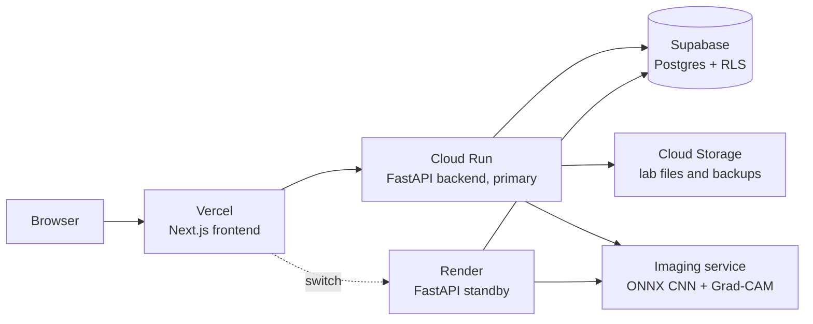

# JoiHealth HMS

A hospital management system with a built-in clinical safety layer, built end to end for a two-branch polyclinic (Lagos and Port Harcourt) and running in production.

It goes beyond record keeping: rules-based clinical checks, AI that explains but never decides, records that cannot be quietly rewritten, and a hosting setup designed to survive a provider failure.

> **Important:** this is clinical decision support, not a medical device. Every clinical threshold in the rules engine is a named default pending confirmation by the clinical team, and every AI output is a draft that a clinician must review.

**Author:** Gboh-Igbara D. Charles, Data Scientist and AI Engineer. Built at JoiHealth Polyclinics.

## Live sites

The same frontend is deployed at three addresses, so there is always one that opens. If one is slow or unreachable, try another.

| Address | Role |
| --- | --- |
| [hms.joihealth.ng](https://hms.joihealth.ng) | Primary, on the clinic's custom domain |
| [joihealth-hms-frontend.vercel.app](https://joihealth-hms-frontend.vercel.app) | The same app on Vercel's own address. It keeps working when the custom domain has DNS problems |
| [joihealth-hms-frontend.onrender.com](https://joihealth-hms-frontend.onrender.com) | Backup copy on Render's free tier. The first visit can take up to a minute while it wakes |

Each address opens the public front page with the clinic's modules and facilities. From there, staff sign in at `/login` and patients use the secure portal at `/portal`.

Sign-in is restricted to clinic staff because the live system holds real patient records, so no demo credentials are published here. For a walkthrough of the screens, features and design decisions, see the [Showcase](#showcase) section.

---

## What makes it different

1. **AI that explains, never decides.** A deterministic rules engine runs first. The AI writes a draft explanation. Nothing is saved until a clinician accepts it.
2. **Records that cannot be quietly rewritten.** Clinical entries are write-once. Admin deletions need a reason and save a full snapshot to a log first.
3. **One clinical core for every department.** Rules live as data, so new departments reuse the same engine, security model and records.
4. **Built to survive failure.** A tested standby backend on a second provider, nightly backups and an offsite copy.
5. **Imaging AI with guardrails, on a small budget.** Body-part checks, honest scores and a memory-tested deployment.

## Modules

| Area | What it covers |
| --- | --- |
| Patients and EMR | Registration, write-once vitals, diagnoses, allergies, immunizations, medications and history |
| Treatment plans and notes | Rich-text plans, immutable clinician notes, ICD, ICF, CPT and HCPCS codes |
| Billing | Invoices, line items, payments, overpayment blocking, PDF export |
| Lab and imaging | Orders, result files, X-ray and MRI analysis with clinician review and sign-off |
| Rehab | Pre-session screening, target zones, prescriptions, programme outcomes, consent records |
| Cardio risk | Quick-entry risk assessment for the cardiology team |
| Pharmacy | Formulary, drug-safety checks, batch and expiry stock, dispensing, returns, controlled drugs register |
| Allied health | Diet and nutrition, physiotherapy, psychology and occupational therapy modules |
| Operations | Appointments, referrals, inventory, requisitions, clinical meeting minutes |
| Dashboards and reports | Role-specific dashboards and weekly progress reports |

Every record type that needs one can be downloaded as a PDF, with the clinic letterhead and footer.

## Architecture



- The frontend never talks to the database directly. Every request goes through the API, which acts on behalf of the signed-in clinician.
- Row-level security (RLS) in Postgres enforces access a second time, so an application bug cannot open a door the database does not allow.
- The standby runs the same code against the same data. Switching is a frontend redeploy that points at the standby address.

## Why it was built this way

Every major choice had a reason. This is the reasoning, grouped by theme.

### Structure and security

| Decision | Why |
| --- | --- |
| The frontend only talks to the API, never the database | One place to check identity and permissions, secrets stay on the server, and every action can be logged and rate-limited |
| Row-level security in Postgres as well | Defence in depth: a bug in the API cannot expose data the database does not allow |
| FastAPI in Python | Rules engines, PDF generation and machine learning live in one language and one service, which suits a small data and AI team |
| Supabase for data and sign-in | Managed Postgres with built-in authentication and RLS, so no database or auth servers to run and patch |
| Next.js on Vercel | Quick deploys, with preview builds so changes can be checked before they go live |

### Resilience and cost

| Decision | Why |
| --- | --- |
| Cloud Run as the primary backend | Scales to zero when idle, and it reaches Gemini through Vertex AI without a stored API key |
| Instance caps, a budget alert and free tiers where possible | Hosting cost stays low and predictable, so the clinic never faces a surprise bill from a traffic spike or a mistake |
| A standby backend on a second provider (Render) | A billing or account problem at one provider would otherwise stop the API, the AI and the backups at once |
| Automatic fallback in the frontend | Staff keep working during an outage without needing to know which server is up. A banner shows while on standby, and traffic returns to the primary on its own |
| A backup copy of the frontend on Render | The custom domain has had outages outside the project's control, so staff always have another way in |
| Nightly versioned backups plus an offsite copy | Versioning protects against bad writes. The offsite copy protects against losing the cloud account itself |

### Records and data integrity

| Decision | Why |
| --- | --- |
| Write-once clinical records | Medical history should never be silently altered, so a correction is a new entry and the trail stays intact |
| Admin deletions need a reason and save a snapshot first | Deleting is sometimes legitimate, such as test data or entry mistakes, but it must stay accountable |
| Totals computed on read, never stored | Stored totals can drift away from the line items they came from |
| Overpayment blocking and vitals range checks | Mistakes are stopped at entry, such as an oxygen saturation of 999 or a diastolic pressure above the systolic. The ranges are wide on purpose, to catch typos and not to judge a patient |
| Letterhead and a shared footer on every PDF | Documents leave the system as official clinic documents |
| Admin-editable front page with built-in fallback text | The clinic can update its own page without a developer, and the page still loads if the backend is down |

### Clinical safety and AI

| Decision | Why |
| --- | --- |
| Rules engine before the AI | Safety checks must be predictable, testable and explainable, which a language model is not |
| AI drafts need an explicit click to save | Responsibility stays with the clinician, and nothing AI-written enters a record unreviewed |
| The AI reads data with the clinician's own sign-in | It can only see what that clinician is allowed to see |
| Drug and safety rules stored as approvable tables (draft, approved, retired) | Pharmacists can maintain and approve rules without a code release, and nothing unapproved is active |
| Thresholds kept as named defaults | Clinical numbers stay visible and changeable, and it is clear they await clinical sign-off |
| Per-patient consent flags | Using patient data for AI or model development needs a recorded decision, and a withdrawal must be respected |
| Rate limits and token caps on the AI assistant | Keeps cost under control and limits abuse |

### Imaging AI

| Decision | Why |
| --- | --- |
| A separate imaging service | The model is too heavy for the main API and the free standby. Separating it keeps the core system light, and lab orders still work if imaging is unavailable |
| ONNX Runtime for inference | A much smaller memory footprint than running a full deep-learning framework |
| Operating-point scores with a reporting margin | The scores are not probabilities, so the report says so and lists only findings above the margin |
| Mismatch checks that block sign-off | The AI once described a possible malignancy on an image of the wrong body part. A reviewer cannot sign off a report about the wrong image |
| Imaging limited to admin, sub-admin and cardiologist | It is used occasionally, it is resource-heavy and it needs clinical oversight |

## Roles

Fourteen staff roles, each with its own access rules and landing page: admin, sub-admin, doctor, clinician, nurse, cardiologist, clinical psychologist, occupational therapist, pharmacist, pharmacy technician, records officer, accountant, procurement and general manager.

## Clinical safety design

- **Rules first.** Screening flags, target heart-rate zones and drug-safety checks come from deterministic code and data tables, not from a model.
- **Explain-only AI.** The language model summarises and explains. It cannot save a clinical decision on its own.
- **Decision log.** Each saved result records the engine version and the flags that fired.
- **Consent tracking.** Per-patient consent history controls whether data may be used for AI-assisted care or model development.
- **Named defaults.** Every threshold is a visible setting, not a buried constant.

## Imaging AI

- A gate refuses images that are not chest X-rays.
- A chest CNN (exported to ONNX) scores 18 findings. Grad-CAM heatmaps are drawn only for findings that are actually reported.
- Scores are operating-point values, where 0.5 is the model's own threshold. They are **not probabilities**, and every report says so.
- Findings are listed only above a reporting margin. Weaker scores appear as one "near the model threshold" line.
- MRI and other studies use a descriptive AI route, with body-part and study-type mismatch checks. Sign-off is blocked while a mismatch finding remains.
- Access is limited to the admin, sub-admin and cardiologist roles.

### Failure cases found and fixed

| Problem | Fix |
| --- | --- |
| Claimed "no change since the previous exam" when no earlier report existed | The prompt now states explicitly when no earlier report exists and forbids comparison claims |
| Described a possible malignancy on an image of the wrong body part | Mismatch checks, a malignancy-wording filter, and sign-off blocked on mismatch |
| Different findings on two runs of the same image | Temperature 0 and a reliability note on descriptive reports |

## Resilience

- **Primary:** Google Cloud Run, with request limits and a per-clinician rate limit on the AI assistant.
- **Standby:** a Render service with the same code and data. The imaging CNN stays on Cloud Run because it does not fit reliably in the standby's memory, so the standby calls it, and the descriptive route works without it.
- **Backups:** nightly database dumps to versioned cloud storage with a 90-day lifecycle, plus an offsite copy.

## Tech stack

- **Frontend:** Next.js (React, TypeScript), TipTap rich-text editor, deployed on Vercel
- **Backend:** FastAPI (Python), reportlab for PDFs, deployed on Cloud Run and Render
- **Data and auth:** Supabase (Postgres, Auth, row-level security)
- **AI:** Gemini through Vertex AI or an API key; ONNX Runtime for the imaging CNN
- **Storage and jobs:** Google Cloud Storage, Cloud Run Jobs and Cloud Scheduler

## Repository layout

The system is split across three repositories:

- `joihealth-hms-backend`: the FastAPI service (`app/routers`, rules engines, PDF code, Dockerfile)
- `joihealth-hms-frontend`: the Next.js application
- `joihealth-imaging-ai`: the ONNX imaging service

## Running locally

### Backend

```bash
python -m venv .venv && source .venv/bin/activate
pip install -r requirements.txt
uvicorn app.main:app --reload
```

Required environment variables: `SUPABASE_URL`, `SUPABASE_ANON_KEY`, `GOOGLE_CLOUD_PROJECT`.
Optional: `SUPABASE_SERVICE_ROLE_KEY`, `GOOGLE_CLOUD_LOCATION`, `ALLOWED_ORIGINS`, `IMAGING_AI_URL`, `IMAGING_AI_KEY`.

### Frontend

```bash
npm install
npm run dev
```

Set `NEXT_PUBLIC_API_URL` to the backend address, plus the Supabase URL and anon key.

A local `npm run build` can fail while prerendering `/login` if the Supabase variables are not set. That is expected without them.

Never commit keys, tokens or `.env` files.

## Security and privacy

- No patient data, credentials or keys belong in this repository.
- Use synthetic demo records only when showing or testing the system.
- Imaging uploads can carry identifiers burned into the pixels, so review images before exporting or sharing them.

## Known limitations and roadmap

- Clinical thresholds and drug-safety rules need sign-off from the clinical team before they are treated as final.
- The built-in ICD, ICF and HCPCS datasets are small samples. The full licensed sets still need to be sourced.
- The imaging CNN is a screening aid, validated only on public sample images so far.
- Hosting is being moved from personal accounts to company-owned accounts.
- Next: pharmacy go-live and clinician training.

## Showcase

A 12-slide walkthrough of the build:

- [View the slides (PDF)](HMS_Knowledge_Showcase.pdf), which opens right in the browser
- [Download the editable PowerPoint](HMS_Knowledge_Showcase.pptx)

## License

To be confirmed with JoiHealth Polyclinics. Until then, all rights are reserved.
